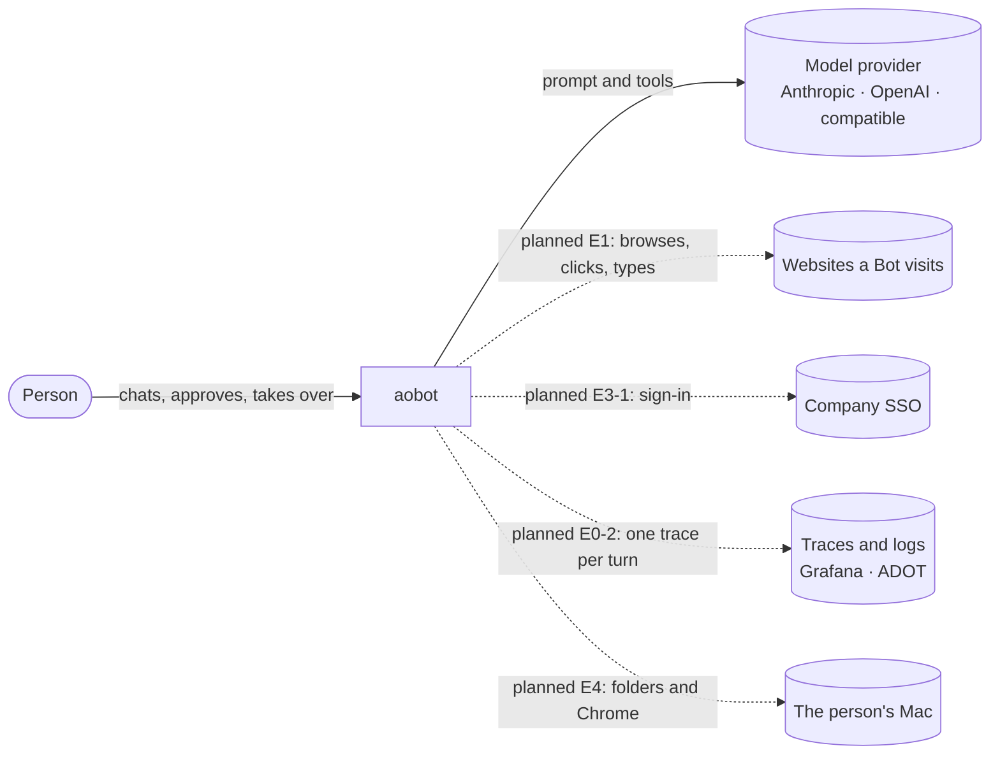

# 3. Context and scope

## Business context

Solid lines exist today. Dotted lines are planned, with the ticket that adds them.

| Partner           | What crosses the boundary                                                                                                                      | Today                                                                                                                                                         |
| ----------------- | ---------------------------------------------------------------------------------------------------------------------------------------------- | ------------------------------------------------------------------------------------------------------------------------------------------------------------- |
| Person            | Messages in, streamed answers out; later approvals, take-over and hand-back                                                                    | Messages and answers ([E0-1](../backlog/E0-walking-skeleton/E0-1-chat-with-a-bot-locally.md))                                                                 |
| Model provider    | The Bot's instructions, the conversation, the tool list; text and tool calls back                                                              | Yes, with an API key (`api` runtime)                                                                                                                          |
| Websites          | Whatever the Bot's browser opens. Treated as untrusted data ([ADR-10](09-architecture-decisions.md#adr-10--outside-content-is-untrusted-data)) | Planned, [E1-1](../backlog/E1-a-computer/E1-1-a-bot-opens-a-page-and-tells-me-its-title.md)                                                                   |
| Company SSO       | Who the person is                                                                                                                              | Planned, [E3-1](../backlog/E3-people/E3-1-sign-in-with-company-sso.md). Today there is no sign-in                                                             |
| Telemetry backend | Spans, logs, metrics over OTLP                                                                                                                 | Planned, [E0-2](../backlog/E0-walking-skeleton/E0-2-one-chat-turn-is-one-trace.md). Grafana runs in Compose, nothing exports to it yet                        |
| The person's Mac  | Folders they picked, a separate Chrome profile                                                                                                 | Planned, [E4-3](../backlog/E4-desktop-app/E4-3-my-bot-works-in-a-folder-on-my-mac.md), [E4-4](../backlog/E4-desktop-app/E4-4-my-bot-uses-chrome-on-my-mac.md) |

## Technical context

| Channel                    | Protocol                                                                                                                     | Defined in                                          |
| -------------------------- | ---------------------------------------------------------------------------------------------------------------------------- | --------------------------------------------------- |
| Browser → server, the page | HTTP, the built web app served as static files with SPA fallback                                                             | `apps/server/src/app/main.ts`                       |
| Browser ↔ server, the chat | One WebSocket at `/rpc`, Effect RPC with JSON serialization: `Chat.open`, `Chat.send` (a stream of `ChatEvent`), `Chat.stop` | `packages/domain/src/chat-rpcs.ts`                  |
| Server → model provider    | HTTPS through the `effect/ai` provider clients, picked by `MODEL_PROVIDER`                                                   | `apps/server/src/features/agent/model-providers.ts` |
| Server → SQLite            | A file at `DATABASE_PATH` through `@effect/sql-sqlite-node`                                                                  | `apps/server/src/features/chat/`                    |
| Server → telemetry         | OTLP over HTTP to port 4318                                                                                                  | Planned, [observability](../observability.md)       |
| Server → computer          | HTTP to "a URL and a token" ([ADR-6](09-architecture-decisions.md#adr-6--a-computer-is-only-ever-a-url-and-a-token))         | Planned, E1-1                                       |
| Desktop app → server       | An outbound connection the app opens; the server never dials a laptop                                                        | Planned, E4                                         |

`ChatEvent` uses AG-UI's event names and fields (`@ag-ui/core` 1.0.2), so an AG-UI client could read the
stream through a thin adapter.

## Out of scope

- A hosted service for others. aobot runs for one company, in its own account.
- Bots that act without a gateway check, even "just this once".
- Generative UI, Bot-to-Bot handoff, routines, memory and the rest of [later.md](../backlog/later.md).
