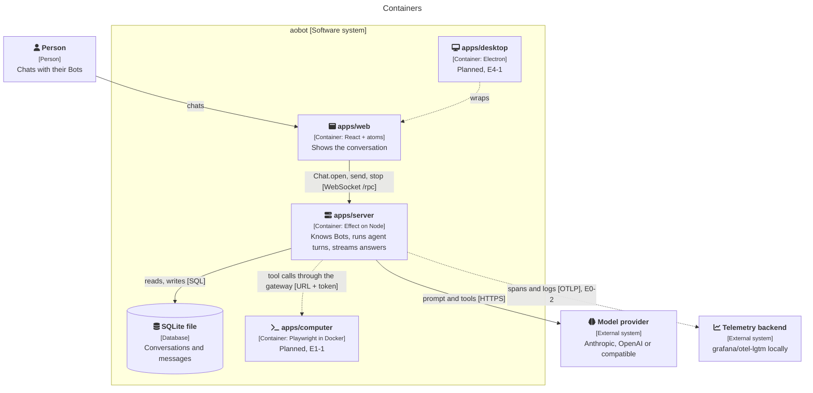
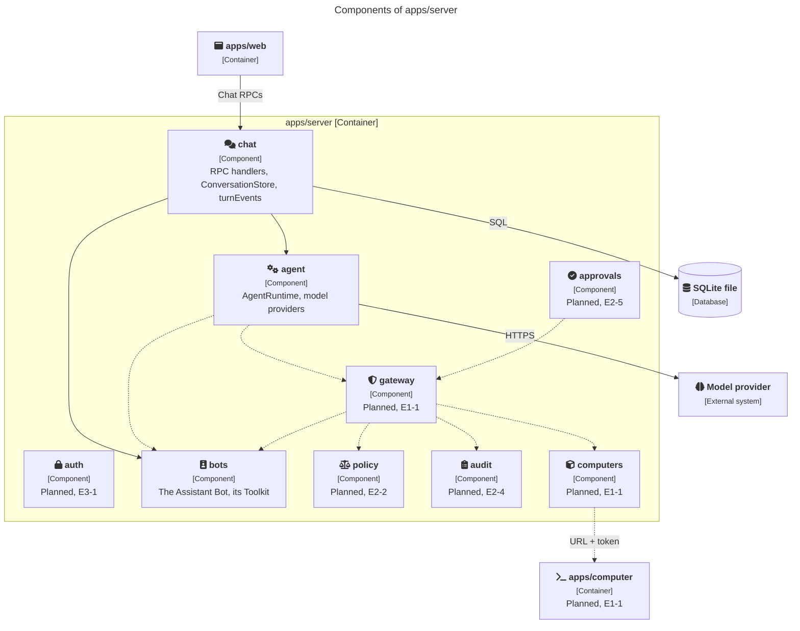

# 5. Building block view

## Level 1: the parts

This C4 container diagram shows what runs and what each part talks to. `packages/domain` is a library the
containers import, not a container, so it appears only in the table below.



Teal boxes are aobot, grey boxes are outside it. Dashed means planned. The server also serves the built
`apps/web` as static files on the same port.

| Part                | Its one job                                                            | Built with                   | Status                                                                                      |
| ------------------- | ---------------------------------------------------------------------- | ---------------------------- | ------------------------------------------------------------------------------------------- |
| `apps/web`          | Show the conversation and the live screen, let a person take the mouse | React + `@effect/atom-react` | The conversation, E0-1                                                                      |
| `apps/desktop`      | Wrap `apps/web`, keep the sign-in token safe, send notifications       | Electron                     | Planned, [E4-1](../backlog/E4-desktop-app/E4-1-the-desktop-app.md)                          |
| `apps/server`       | Know Bots and people, run agent turns, stream answers                  | Effect on Node               | Chat with one Bot, E0-1                                                                     |
| Gateway (in server) | Decide if a tool call may happen, record it, then forward it           | Effect service + database    | Planned, [E1-1](../backlog/E1-a-computer/E1-1-a-bot-opens-a-page-and-tells-me-its-title.md) |
| `apps/computer`     | Actually do it: browse, click, type, run commands                      | Node + Playwright in Docker  | Planned, E1-1                                                                               |
| `packages/domain`   | Schemas shared by all of the above                                     | Effect Schema                | `ChatEvent`, `ChatRpcs`, ids                                                                |
| `apps/docs`         | Render `docs/` as this site                                            | Astro Starlight              | This site                                                                                   |

Workspaces import each other only by package name (`@aobot/domain`). Which workspace may import which is
declared in `tools/oxlint/aobot-architecture/policy.ts`.

## Inside each app: features

Each app is split by feature, not by technical layer. `src/app` wires things together,
`src/features/<feature>` holds one capability end to end with `public.ts` as its only entry point, and
`src/shared` holds generic helpers. Which feature may use which is declared in `policy.ts` and enforced
by oxlint. See [quality gates § Feature-based architecture](../quality-gates.md#feature-based-architecture).

The agent never talks to a computer directly. It can only ask, and the gateway answers. The feature graph
enforces this: only the `gateway` feature may depend on `computers`.

### `apps/server`

This C4 component diagram shows the server's features. Each arrow between two features is a dependency
`policy.ts` allows; any other import across features fails lint.



Solid arrows are imports or calls that exist today; dashed ones arrive with their tickets. `computers` is
reached only through `gateway`, which is how "every action goes through the gateway" is enforced.

| Feature     | What it holds today                                                                                                                                                        | Status                                                                                                           |
| ----------- | -------------------------------------------------------------------------------------------------------------------------------------------------------------------------- | ---------------------------------------------------------------------------------------------------------------- |
| `chat`      | The `ChatRpcs` handlers, `ConversationStore` on SQLite and its migration, the one-run-per-conversation guard, and `turnEvents`, which turns agent events into AG-UI events | E0-1                                                                                                             |
| `agent`     | The `AgentRuntime` service and its `api` implementation, the model providers table, and the boot-time model check                                                          | E0-1                                                                                                             |
| `bots`      | The one hard-coded Bot (`Assistant`) and an empty `Toolkit`                                                                                                                | E0-1; Bots from a file in [E2-1](../backlog/E2-roles-and-guardrails/E2-1-bots-from-a-file-with-granted-tools.md) |
| `gateway`   | Grant check, rules, audit row, forward                                                                                                                                     | Planned, E1-1                                                                                                    |
| `computers` | The `Computers` service and its providers                                                                                                                                  | Planned, E1-1                                                                                                    |
| `policy`    | Rules that fail closed                                                                                                                                                     | Planned, [E2-2](../backlog/E2-roles-and-guardrails/E2-2-rules-that-fail-closed.md)                               |
| `audit`     | Append-only audit rows                                                                                                                                                     | Planned, [E2-4](../backlog/E2-roles-and-guardrails/E2-4-an-audit-page-people-can-read.md)                        |
| `approvals` | Ask the person before a risky action                                                                                                                                       | Planned, [E2-5](../backlog/E2-roles-and-guardrails/E2-5-ask-before-risky-actions.md)                             |
| `auth`      | Sign-in                                                                                                                                                                    | Planned, [E3-1](../backlog/E3-people/E3-1-sign-in-with-company-sso.md)                                           |

`src/app` holds `config.ts` (every setting through Effect `Config`) and `main.ts`, which builds the
layers: the SQLite client with migrations at boot, the agent runtime on the configured model, the RPC
server on `/rpc`, the static web app, and the model check.

### `apps/web`

React with `@effect/atom-react`. State lives in atoms from `effect/reactivity`; components read them
through a few hooks. The hooks copy the _shape_ of CopilotKit's
(`~/Projects/opensource/CopilotKit/packages/react-core/src/v2/hooks/`), not their mechanics: no Bot
tool ever runs in the page, so nothing depends on a tab being open.

The `chat` feature has the RPC client (`ChatClient`, an `AtomRpc.Service` over one WebSocket), one
family of atoms per conversation (`state`, `open`, `send`, `stop`), and a pure `foldChatEvent` that turns
each event into the next conversation state.

| Hook                    | Shaped like CopilotKit's             | What it gives a component                                                               | Status                                                                                      |
| ----------------------- | ------------------------------------ | --------------------------------------------------------------------------------------- | ------------------------------------------------------------------------------------------- |
| `useConversation(id)`   | `useAgent`                           | `bot`, `messages`, `isRunning`, `error`, `send`, `stop`                                 | E0-1                                                                                        |
| `useToolCallRenderer()` | `useRenderTool`, `useRenderToolCall` | A registry from tool name to a component that draws one tool call in each of its states | Planned, [E1-1](../backlog/E1-a-computer/E1-1-a-bot-opens-a-page-and-tells-me-its-title.md) |
| `useLiveScreen(bot)`    | (none)                               | The latest screen frame, and `takeControl` and `handBack`                               | Planned, [E1-4](../backlog/E1-a-computer/E1-4-watch-the-live-screen.md)                     |

Not copied: `useFrontendTool` (it runs a Bot's tool in the open tab, which breaks routines, the Mac and
closed tabs) and CopilotKit's provider.

### `packages/domain`

| Module          | What it defines                                                                                                                                    |
| --------------- | -------------------------------------------------------------------------------------------------------------------------------------------------- |
| `chat-event.ts` | `ChatEvent`: `RUN_STARTED`, `TEXT_MESSAGE_START`, `TEXT_MESSAGE_CONTENT`, `TEXT_MESSAGE_END`, `RUN_FINISHED`, `RUN_ERROR`, and the `RunErrorCode`s |
| `chat-rpcs.ts`  | `ChatRpcs` (`Chat.open`, `Chat.send`, `Chat.stop`), `Message`, `ConversationSnapshot`, `SendMessage`, `ConversationBusy`, `MessageAlreadySent`     |
| `ids.ts`        | Branded ids: `ConversationId`, `RunId`, `MessageId`, `BotId`                                                                                       |

It runs in the server, the page and later the desktop app, so the `domain-purity` lint rule keeps Node
built-ins, React and Electron out of it.

## Level 2: the provider services

### `AgentRuntime`

The think-act loop is a provider, like a computer. One `AgentRuntime` service with one operation,
`run(turn)`, which returns a stream of `TextDelta` and `Done`, or fails with `Stalled`, `StepLimit` or
`ModelFailed`. Two implementations, chosen by `AGENT_RUNTIME` once the second one exists:

| Runtime | Where              | Model and billing                                                                 | How tools reach the gateway                                                                                    | Status                                                                              |
| ------- | ------------------ | --------------------------------------------------------------------------------- | -------------------------------------------------------------------------------------------------------------- | ----------------------------------------------------------------------------------- |
| `api`   | Cloud, and locally | Any provider with an API key: Anthropic, OpenAI, OpenAI-compatible, OpenRouter    | `effect/ai` `LanguageModel` with our own loop. The `Toolkit` handlers _are_ the gateway; there is nothing else | E0-1, the only runtime today                                                        |
| `acp`   | Laptop only        | The person's own subscription: Claude Code, Codex or OpenCode, spoken to over ACP | Our tools offered as one MCP server in `session/new`. Built-in tools are switched off                          | Planned, [E0-5](../backlog/E0-walking-skeleton/E0-5-chat-on-my-own-subscription.md) |

The `api` loop: one step is one `Chat.streamText` call. A step that called tools leads to another, up to
`AGENT_MAX_STEPS` (8). No event from the model for `AGENT_STALL_TIMEOUT_MS` (60 s) fails the turn with
`Stalled`.

Whatever the runtime, the only tools a Bot has are gateway tools. For `acp` that is not the default, so it
will be enforced three ways:

1. The CLI is started with its own tools switched off and only the gateway MCP server offered.
2. Every `session/request_permission` and every client-side `fs/*` or `terminal/*` request is refused unless
   it names a gateway tool, and the refusal is an audit row.
3. The agent runtime contract suite asks each CLI, through the scripted model, to run a shell command and
   read a file outside the gateway. Both must fail. A CLI that fails the suite is not supported.

`acp` runs on one person's subscription, so it is refused at start-up unless single-user mode is on and the
server listens on loopback. A subscription is never shared between people and never runs in the cloud.

### `Computers` (planned, E1-1)

Four operations, the same as OpenBot's supervisor:

```ts
export interface Interface {
  readonly ensure: (person: PersonId) => Effect.Effect<Handle, Unavailable>; // start if needed, wait until healthy
  readonly stop: (person: PersonId) => Effect.Effect<void, Unavailable>;
  readonly reset: (person: PersonId) => Effect.Effect<void, Unavailable>;
  readonly list: Effect.Effect<ReadonlyArray<ComputerStatus>, Unavailable>;
}
```

Every provider passes the same contract suite before it is used. See [testing](../testing.md).

### Two computers: the cloud one and your Mac (planned, E4)

A Bot always has its cloud computer. While the desktop app is open and signed in, it can also use the
person's own Mac. Every computer tool takes a `computer` argument, `cloud` or `mac`, and rules see it as
`computer.kind`.

|                   | Cloud computer                               | Your Mac                                                                                           |
| ----------------- | -------------------------------------------- | -------------------------------------------------------------------------------------------------- |
| Exists            | Always; started on demand, stopped when idle | Only while the desktop app is open and signed in as its owner                                      |
| How it is reached | The server calls it: "a URL and a token"     | The desktop app connects out to the server and pulls work; the server never dials a laptop         |
| Files             | `/workspace`                                 | Only folders the person picked in the macOS folder dialog, one grant per Bot, revocable            |
| Shell             | `bash` in the container                      | Per command, a native "Allow?" dialog by default, run in a sandbox without network                 |
| Browser           | The Bot's Chromium                           | The person's installed Chrome with a separate aobot profile, never their own profile               |
| Who may use it    | The Bots of the person it belongs to         | The Bots of the signed-in owner only, never another person's, never a routine with nobody watching |

The gateway is still the only door: grant, rules, audit row, then forward. The Mac adds a second check on
the Mac itself, the native dialog, because a rule written on the server cannot see what is on the
person's disk. When the app is closed, a `mac` call fails with "your Mac is not connected" rather than
waiting.

## Outside the apps

| Folder         | What it holds                                                                                                                   |
| -------------- | ------------------------------------------------------------------------------------------------------------------------------- |
| `verify/`      | Tier 4: `vp run verify <ticket>` starts Compose with a mock model and replays `verify/scenarios/<ticket>.ts` in `agent-browser` |
| `tools/oxlint` | The lint plugins: `aobot-architecture` (boundaries, public API, domain purity), `aobot-standards`, vendored `anti-slop`         |
| `tools/docs`   | Tests that keep these docs honest: the backlog's front-matter and every page's title and description                            |
| `docs/`        | These pages. The Starlight app in `apps/docs` renders them in place                                                             |
