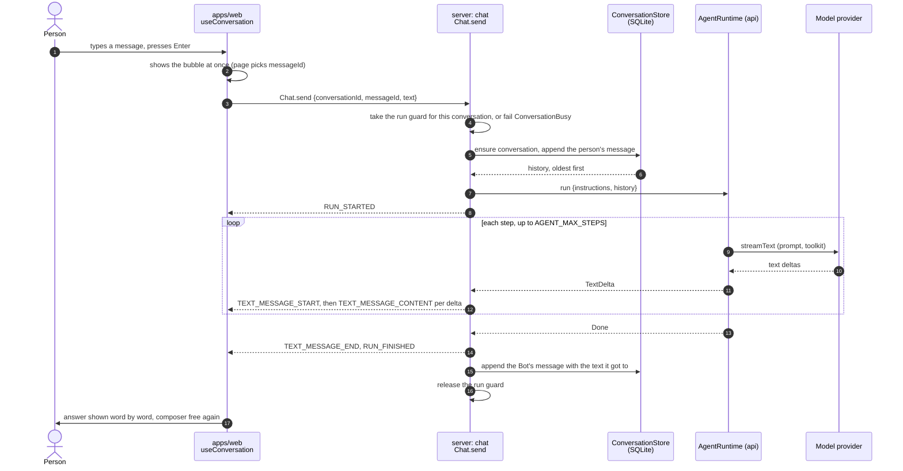
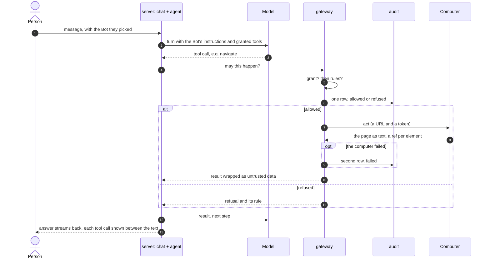

# 6. Runtime view

## One chat turn (today, E0-1)

A person sends a message. The answer streams back as AG-UI events over the one WebSocket.

What the code guarantees along the way:

- **The guard is taken before anything is stored.** The check and the insert into the in-memory map run in
  one synchronous step, so two sends cannot both pass. It is released when the stream ends, however it ends.
- **A retried send is stored once.** Messages are appended with `ON CONFLICT (id) DO NOTHING` on the id the
  page picked.
- **The Bot's message is stored when the run ends**, finished or not, with the text it got to. Nothing is
  stored when it said nothing.
- **The server turns agent events into AG-UI events with a small state machine** (`turn.ts`: `Waiting`,
  `Writing`, `Ended`), so `TEXT_MESSAGE_END` is sent exactly when a message was started.

## How a turn ends early

Every early end is one `RUN_ERROR` with a `code` the page can read. A second message is refused before any
run starts.

| What happened                                               | Agent side                                | Event                    | What the person sees                                                           |
| ----------------------------------------------------------- | ----------------------------------------- | ------------------------ | ------------------------------------------------------------------------------ |
| The model sent nothing for 60 s                             | `Stalled`                                 | `RUN_ERROR` `stalled`    | "The model sent nothing for 60 seconds…" and a hint to resend                  |
| The Bot kept calling tools past the step cap                | `StepLimit`                               | `RUN_ERROR` `step_limit` | "The Bot took 8 steps without finishing…"                                      |
| The provider refused or broke the request                   | `ModelFailed` (reason only in the log)    | `RUN_ERROR` `model`      | "The model provider could not answer. The server log says why."                |
| The person pressed stop                                     | `Chat.stop` completes the turn's signal   | `RUN_ERROR` `stopped`    | The words so far stay; the conversation is idle, not failed                    |
| A turn is already running in this conversation              | `Chat.send` fails with `ConversationBusy` | none                     | The bubble is taken back: "Bot is still answering…"                            |
| The server could not be reached, or the stream closed early | none                                      | none                     | "Cannot reach the server." or "The connection closed before the Bot finished." |

The stall clock only measures the model. When the page reads slowly the clock waits, so a slow reader is
never blamed for a quiet model.

## Opening and reloading a conversation

The page keeps the conversation id in the URL (`?c=…`). On load, `Chat.open` returns a
`ConversationSnapshot`: the Bot, every stored message, and whether a run is in flight. The page seeds its
state from it, so a reload after an answer shows the whole conversation. A reload _during_ a run is a known
gap, see [section 11](11-risks-and-technical-debt.md).

## The life of a tool call (planned, E1 and E2)

Once Bots have tools, every action goes through the same door.

1. A person sends a message with the Bot they picked.
2. The server starts an agent turn with the Bot's instructions and its granted tools.
3. The agent asks for a tool, for example `navigate`.
4. The gateway checks the grant, then the rules, and writes one audit row either way.
5. Only on "yes", the gateway asks the person's computer to act. If the computer then fails, the gateway
   writes a second row, `failed`, so "allowed" never reads as "done".
6. The computer returns the page as text: the accessibility tree, with a ref per element.
7. The gateway wraps it as untrusted data ([ADR-10](09-architecture-decisions.md#adr-10--outside-content-is-untrusted-data)) before the agent sees it.
8. The agent reads it and decides the next step. Every step goes through the same door.
9. The answer streams back to the page, with each tool call shown between the text.

Tickets: [E1-1](../backlog/E1-a-computer/E1-1-a-bot-opens-a-page-and-tells-me-its-title.md) (the gateway
and the first tool), [E2-2](../backlog/E2-roles-and-guardrails/E2-2-rules-that-fail-closed.md) (rules),
[E2-4](../backlog/E2-roles-and-guardrails/E2-4-an-audit-page-people-can-read.md) (the audit page).
