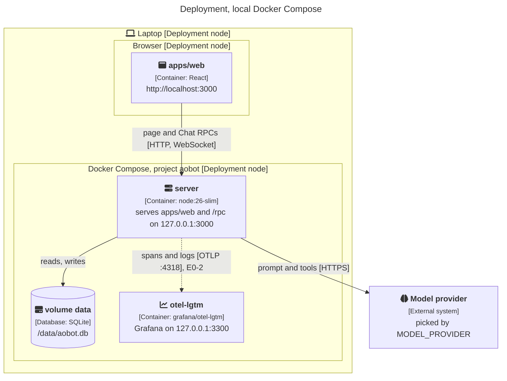

# 7. Deployment view

## Local now: Docker Compose

This C4 deployment diagram shows one laptop. Outlined boxes are where things run; the filled boxes inside
them are the containers from the [building block view](05-building-block-view.md).

Teal is ours, grey is someone else's image or service. The dashed arrow is planned in
[E0-2](../backlog/E0-walking-skeleton/E0-2-one-chat-turn-is-one-trace.md).

| Node        | What runs                                                                                                                                  | Settings                                                                                                                                              |
| ----------- | ------------------------------------------------------------------------------------------------------------------------------------------ | ----------------------------------------------------------------------------------------------------------------------------------------------------- |
| `server`    | One image from the root `Dockerfile`: installs with the pinned pnpm, builds `apps/web`, then runs `apps/server/src/app/main.ts` on Node 26 | `.env` (from `.env.example`): `MODEL_PROVIDER`, `MODEL_NAME`, `MODEL_API_KEY`, optional `MODEL_BASE_URL`. Compose sets `DATABASE_PATH=/data/aobot.db` |
| `data`      | A named volume with the SQLite file. Only the server mounts it                                                                             |                                                                                                                                                       |
| `otel-lgtm` | `grafana/otel-lgtm`: Grafana, Tempo, Loki and an OTLP collector in one container                                                           | Grafana on http://localhost:3300                                                                                                                      |

Compose publishes both ports on `127.0.0.1` only, so nothing outside the laptop reaches them.

The server checks the model at boot (one request to the provider) and logs how to fix a wrong key or model
name. It never refuses to start over it.

`vp run verify <ticket>` adds `verify/compose.yml` on top: a `mock-model` service that speaks OpenAI Chat Completions and answers
every request with the same sentence, word by word, and the server pointed at it. It runs under its own project name,
`aobot-verify`, and removes its volumes before and after, so a run starts from an empty database.

Computers are planned ([E1-1](../backlog/E1-a-computer/E1-1-a-bot-opens-a-page-and-tells-me-its-title.md)):
one container per person from `apps/computer`, on a network only the server can reach, with a named
volume for its logins.

## Local now, AWS later

Two switches decide where things run. Code never checks which one is active.

| Switch                           | Local (now)                                                       | AWS (later)                                                      |
| -------------------------------- | ----------------------------------------------------------------- | ---------------------------------------------------------------- |
| `AGENT_RUNTIME`                  | `api` with a key today; `acp` on your own subscription from E0-5  | `api` only                                                       |
| `COMPUTER_PROVIDER`              | `docker`: one container per person, a named volume for its logins | `ecs` (RunTask in a private subnet), later `k8s` (agent-sandbox) |
| `OTEL_EXPORTER_OTLP_ENDPOINT`    | the `grafana/otel-lgtm` container                                 | the AWS OpenTelemetry collector (ADOT) or Grafana Cloud          |
| `DATABASE_PATH` / `DATABASE_URL` | a SQLite file on a Compose volume (`DATABASE_PATH`)               | RDS Postgres with pgvector (`DATABASE_URL`)                      |
| Secrets                          | `.env` through Effect `Config`                                    | AWS Secrets Manager                                              |
| Model                            | Whatever your CLI uses, or any `effect/ai` provider with a key    | Any `effect/ai` provider; Bedrock is decided in E5-1             |

Of these switches, only `DATABASE_PATH` and the model settings are read today. The others arrive with their tickets.

Rules that keep the move cheap:

1. SQLite locally, Postgres on AWS. One server process needs one file, not a database container. Moving to
   the cloud means switching to Postgres then ([E5-1](../backlog/E5-aws/E5-1-aobot-in-our-aws-account.md)),
   and the in-memory one-run-per-conversation guard becomes a shared lock the day there is a second
   replica. SQL stays inside the feature stores so that switch stays in one place.
2. Settings and secrets only through Effect `Config`, never `process.env` in application code.
3. Computers never publish ports. Only the server's network can reach them.
4. The images Compose runs are the images AWS runs.
5. Every computer provider passes the same contract test suite before it is used. See [testing](../testing.md).

## AWS later (planned, E5)

| Piece       | Where it runs                                                                  | Ticket                                                                    |
| ----------- | ------------------------------------------------------------------------------ | ------------------------------------------------------------------------- |
| Server      | Our AWS account, the same image                                                | [E5-1](../backlog/E5-aws/E5-1-aobot-in-our-aws-account.md)                |
| Database    | RDS Postgres                                                                   | E5-1                                                                      |
| Computers   | One ECS task per person in a private subnet                                    | [E5-2](../backlog/E5-aws/E5-2-computers-as-ecs-tasks.md)                  |
| Credentials | IMDSv2 with hop limit 1, metadata range blocked, so a Bot's shell gets nothing | [E5-3](../backlog/E5-aws/E5-3-computers-cannot-reach-aws-credentials.md)  |
| Kubernetes  | An optional provider when ECS is outgrown                                      | [E5-4](../backlog/E5-aws/E5-4-kubernetes-provider-when-we-outgrow-ecs.md) |

The desktop app talks to the AWS server; a Mac is reached only through the connection the app opens.
