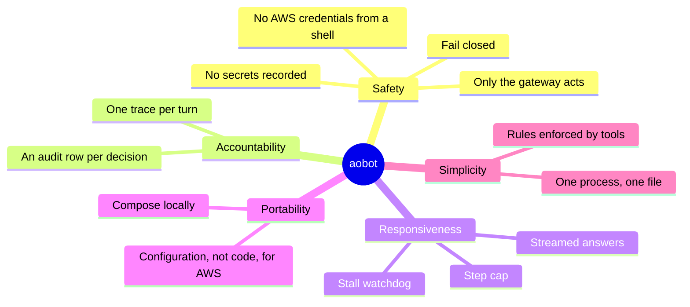

# 10. Quality requirements

## Quality tree

## Scenarios

Each scenario names who or what triggers it, what aobot does, and how we know. "Met" means a test or the
ticket's `verify` scenario proves it today.

| #   | Quality         | Scenario                                                                                                         | Measure                                                                                                          | Status                                                                                                                                                                        |
| --- | --------------- | ---------------------------------------------------------------------------------------------------------------- | ---------------------------------------------------------------------------------------------------------------- | ----------------------------------------------------------------------------------------------------------------------------------------------------------------------------- |
| Q1  | Responsiveness  | A person sends a message. The answer appears word by word as the model writes it                                 | The page shows at least two partial states before the full answer                                                | Met: `verify/scenarios/E0-1.ts`                                                                                                                                               |
| Q2  | Responsiveness  | The model sends nothing for 60 s (`AGENT_STALL_TIMEOUT_MS`)                                                      | The turn ends with `RUN_ERROR` `stalled` and a message to resend. A slow reader is not blamed                    | Met: `api-runtime.test.ts`, `handlers.test.ts` (`TestClock`)                                                                                                                  |
| Q3  | Responsiveness  | A model keeps calling tools                                                                                      | The turn stops after `AGENT_MAX_STEPS` (8) with `step_limit`                                                     | Met: `api-runtime.test.ts`                                                                                                                                                    |
| Q4  | Consistency     | A person sends a second message while a turn runs in the same conversation                                       | Refused with `ConversationBusy`, not queued; the page takes the bubble back. A new send works once the turn ends | Met: `handlers.test.ts`, `conversation.test.ts`                                                                                                                               |
| Q4b | Consistency     | The page retries a send whose message the server already stored                                                  | No second run and no second copy; the page keeps one bubble and goes idle                                        | Met: `handlers.test.ts`, `conversation.test.ts`                                                                                                                               |
| Q5  | Durability      | A person reloads the page after an answer                                                                        | The whole conversation is shown, read from SQLite                                                                | Met: `verify/scenarios/E0-1.ts`                                                                                                                                               |
| Q6  | Control         | A person presses stop during an answer                                                                           | The run ends with `stopped`; the words so far stay on the page and in the database                               | Met: `handlers.test.ts`, `conversation-state.test.ts`                                                                                                                         |
| Q7  | Operability     | The server starts with a wrong API key or model name                                                             | One log line at boot says what is wrong and how to fix it. The server still starts                               | Met: `model-check.test.ts`                                                                                                                                                    |
| Q8  | Maintainability | A change imports across a feature boundary the policy does not allow, or reads `process.env` outside `config.ts` | `vp run check` fails locally and in CI                                                                           | Met: the rule tests in `tools/oxlint`, [E0-4](../backlog/E0-walking-skeleton/E0-4-quality-gates-and-ci.md)                                                                    |
| Q9  | Safety          | A rule is missing, or crashes, or a Bot calls a tool it was not granted                                          | Refused. Nothing reaches a computer                                                                              | Planned: [E2-2](../backlog/E2-roles-and-guardrails/E2-2-rules-that-fail-closed.md), [E2-1](../backlog/E2-roles-and-guardrails/E2-1-bots-from-a-file-with-granted-tools.md)    |
| Q10 | Accountability  | A Bot calls any tool                                                                                             | Exactly one audit row before it runs, a second `failed` row if the computer fails, none rewritable               | Planned: [E1-1](../backlog/E1-a-computer/E1-1-a-bot-opens-a-page-and-tells-me-its-title.md), [E2-4](../backlog/E2-roles-and-guardrails/E2-4-an-audit-page-people-can-read.md) |
| Q11 | Safety          | A Bot types a password into a page                                                                               | Audit rows, logs and spans show its length, never the value                                                      | Planned: [E2-3](../backlog/E2-roles-and-guardrails/E2-3-never-record-secrets.md)                                                                                              |
| Q12 | Accountability  | Security opens one chat turn in Grafana                                                                          | One trace, with a span per model call and tool call                                                              | Planned: [E0-2](../backlog/E0-walking-skeleton/E0-2-one-chat-turn-is-one-trace.md)                                                                                            |
| Q13 | Safety          | A Bot's shell on AWS asks `169.254.169.254` for credentials                                                      | It gets nothing                                                                                                  | Planned: [E5-3](../backlog/E5-aws/E5-3-computers-cannot-reach-aws-credentials.md)                                                                                             |
| Q14 | Portability     | aobot moves from Compose to our AWS account                                                                      | Configuration and providers change; no application code checks where it runs                                     | Planned: [E5-1](../backlog/E5-aws/E5-1-aobot-in-our-aws-account.md)                                                                                                           |
